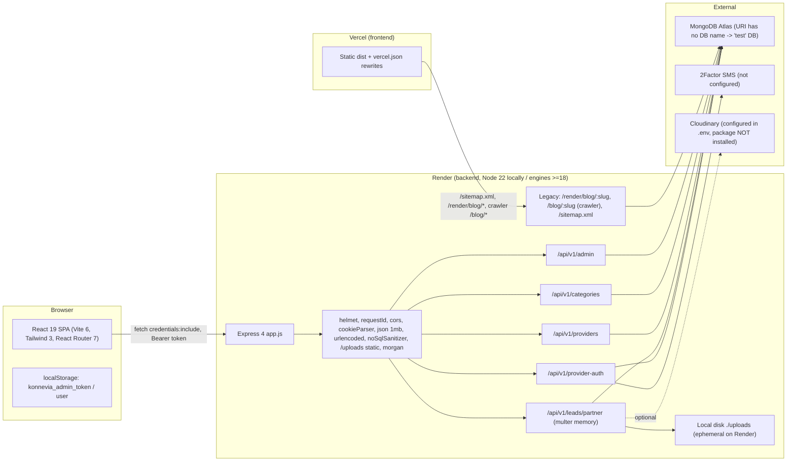
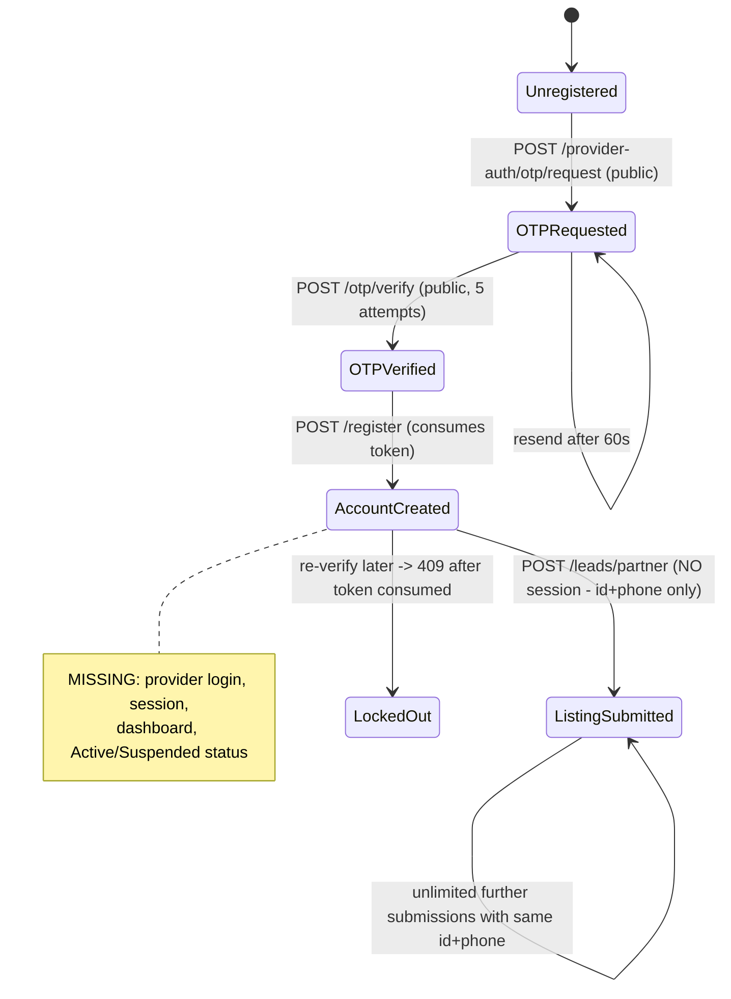
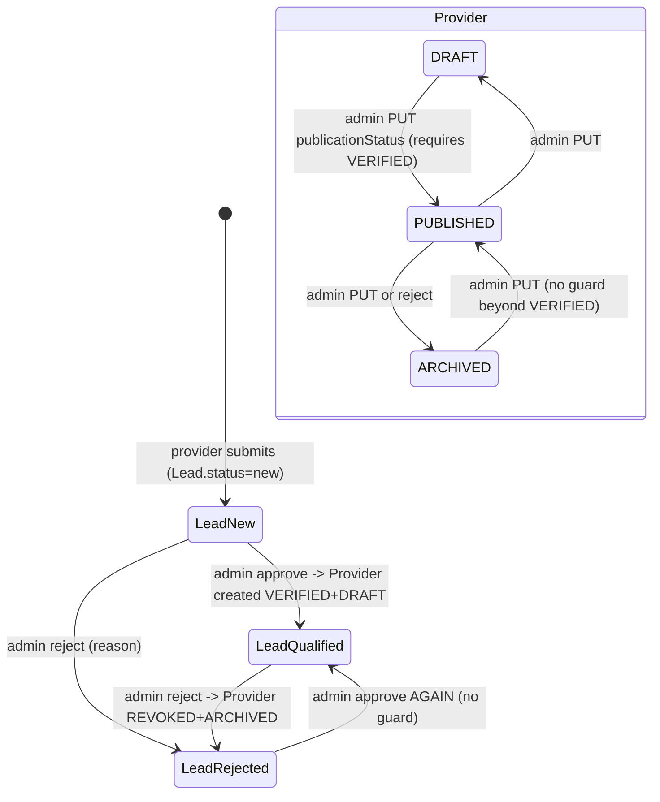
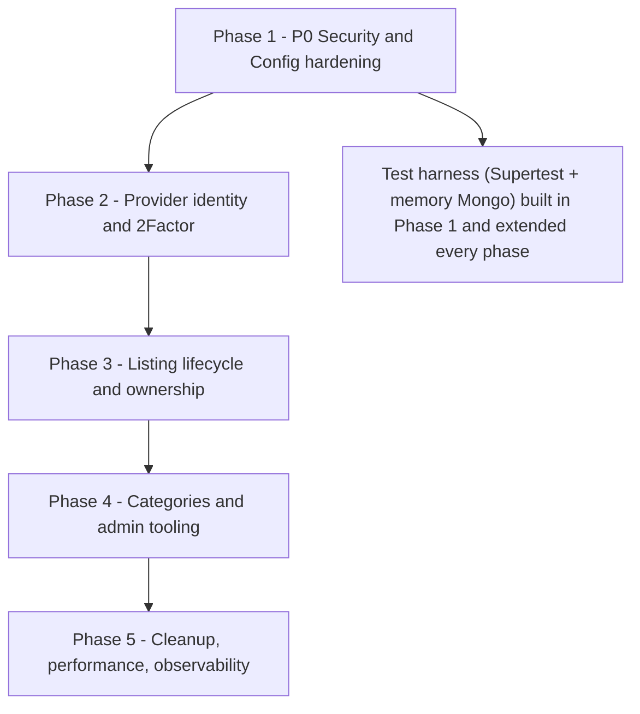

# WARESHOP — Phase 0: Forensic Architecture, Security & Business Logic Audit

| Item | Value |
|---|---|
| Audit date | 2026-11-14 |
| Scope | Entire repository `d:\projects\wareshop` (backend, frontend, docs, test scripts, deploy config) |
| Mode | **Audit only.** No application code, schema, data, dependency or auth change was made. |
| Git state | Single commit `e25c96e Initial commit` + large uncommitted working tree (≥30 modified files) |
| Evidence standard | Every finding cites a file/line or a command result. Anything not proven is marked **UNVERIFIED**. |

### Commands executed during audit (all read-only)

| Command | Purpose | Result |
|---|---|---|
| `npm ls --depth=0` (backend, frontend) | Installed versions | See §9 |
| `npm audit` (backend `--omit=dev`, frontend) | Known CVEs | **0 vulnerabilities** in both (registry advisory DB at audit time) |
| `npm outdated` | Version drift | See §9 |
| `vite build --outDir <artifact scratch dir>` | Bundle size (built outside repo) | See §8 |
| One-off Node script: `mongoose.connect` + `admin().ping()` only, URI redacted, script deleted afterwards | DB reachability | **PING OK in 889 ms**; URI scheme `mongodb+srv`; **no database name in URI** |
| `.env` key listing (values never printed, only "set/empty") | Configuration inventory | See §5.4 / §12 |
| `git ls-files` | Secret tracking check | `.env` files **not** tracked ✅ |

**Not executed:** the repository's test scripts. They perform writes against MongoDB and the audit rules forbid modifying data. All test outcomes are therefore **UNVERIFIED** (see §10).

---

## 1. Executive Technical Assessment

WARESHOP is a small, readable Express + Mongoose API and a React 19/Vite SPA. Some foundations are good: scrypt password hashing with constant-time comparison, HttpOnly admin cookie, Helmet, a NoSQL key sanitizer, a 1 MB body limit, a strict public visibility gate (`VERIFIED` + `PUBLISHED`), the contact number moved behind a separate rate-limited endpoint, OTPs generated with `crypto.randomInt` and stored only as hashes, and `npm audit` reporting zero known vulnerabilities.

**The application is not production-ready.** The audit found blocking problems in three areas:

1. **The core provider workflow cannot run end to end.**
   - SMS OTP delivery is not configured: the local `.env` has no `TWOFACTOR_*` keys.
   - The 2Factor adapter calls an endpoint and reads a response shape that do not match 2Factor's public documentation. Delivery has never been verified (§5.2).
   - No provider login, session or dashboard exists. A listing has no link back to the provider account that created it, so "provider manages own listing" is **not implemented** (§6).
   - A provider who has already registered can never verify again. Registration returns `409` after the one-time token has been consumed (§5.2).

2. **Critical/high security gaps.**
   - Hard-coded fallback SUPER_ADMIN credentials are auto-provisioned at boot.
   - Rate limiting is broken behind the Render/Vercel proxy because `trust proxy` is not set.
   - Listing submission has no authentication; it relies only on a predictable ObjectId plus a phone number.
   - Mass assignment into the `Lead` document.
   - CSRF against admin POST endpoints (SameSite=None cookie + urlencoded parser).
   - Race conditions in the OTP controls let callers bypass the cooldown and the attempt limit, which also opens the door to SMS-pumping cost abuse.

3. **Reliability and data-integrity defects.**
   - Mongoose buffers commands during an outage, which is the root cause of the previously reported "buffering timed out" errors. `/health` returns 200 even when the DB is down.
   - Admin approval is non-atomic and has no state guard, so duplicate providers are possible.
   - Free-text categories bypass the category system.
   - The frontend silently shows **hard-coded sample listings** when the API is empty or unreachable.
   - The frontend and API disagree on field names, so real listings render with a blank category and location.
   - Uploaded images go to Render's ephemeral disk and are stored with relative URLs that break on Vercel.

A large amount of out-of-scope legacy code is still present or reachable: blog SSR routes, enquiry/contact lead types, Google-Sheets fields, `/get-quote` CTAs, a routed `/services/:slug` page, and unrouted blog/enquiry admin pages. The existing "tests" are ad-hoc scripts that target endpoints which no longer exist.

**Overall rating:** Security **High risk** · Business-logic completeness **~45 %** of the authoritative model · Production readiness **Not ready** · Code size small enough to fix in 3–4 focused phases.

---

## 2. Actual Architecture

### 2.1 Backend layout (`backend/`)

| Layer | Files | Notes |
|---|---|---|
| Entry | `server.js` | Connect DB → bootstrap admin → listen; SIGTERM/SIGINT close HTTP only |
| App | `src/app.js` | Middleware chain, legacy blog SSR routes, API mount |
| Config | `src/config/env.js`, `src/config/db.js` | Insecure defaults (§7 SEC-01); no env validation |
| Routes | `src/routes/{index,adminRoutes,providerAuthRoutes,providerRoutes,categoryRoutes,leadRoutes,blogRoutes}.js` | `blogRoutes.js` **not mounted** (dead) |
| Controllers | `adminAuth, adminProvider, providerAuth, provider, category, lead, health, sitemap, render, blog, adminBlog` | `blog`, `adminBlog` unmounted; `render` still mounted |
| Services | `authService, leadService, storageService, twoFactorService, activityLogger` | `leadService.createEnquiry/createContactLead` dead |
| Middleware | `auth.js` (requireAdmin, requireRole), `security.js`, `validate.js`, `upload.js`, `errorHandler.js` | `requireRole` **never used**; `validateEnquiry/validateContact` dead |
| Models | `Admin, ProviderAccount, OtpChallenge, Lead, Provider, Category, CustomCategoryRequest, ActivityLog, Blog` | `Blog` out of scope |
| Scripts | `bootstrapAdmin, seedCategories, seedDemoProviders, publishBlog` | `publishBlog` out of scope |
| Utils | `apiResponse, logger, referenceId` | Console-only logger |

### 2.2 Frontend layout (`frontend/src`)

| Area | Files | Notes |
|---|---|---|
| Routing | `routes/AppRoutes.jsx` | Lazy routes. Public: `/`, `/categories`, `/categories/:slug`, **`/services/:slug`** (out of scope), `/providers`, `/providers/:slug`, `/become-a-partner`, `/about`, `/privacy-policy`, `/terms`. Admin: login, dashboard, applications, providers, categories, activity-logs, settings |
| Auth | `context/AuthContext.jsx`, `components/admin/ProtectedRoute.jsx` | Token in `localStorage` |
| API | `services/api.js`, `providerService.js`, `leadService.js`, `blogService.js` | `leadService.submitEnquiry/submitContactMessage` and all of `blogService` hit non-existent endpoints |
| Static data | `data/providers.js`, `data/services.js`, `data/categories.js` | Used as **runtime fallback** for public listings |
| Dead pages (not routed) | `AdminEnquiriesPage`, `AdminBlogsPage`, `AdminBlogEditorPage`, `BlogListPage`, `BlogDetailPage`, `GetQuotePage`, `ContactPage` | ~120 KB of dead source |

### 2.3 Deployment configuration

| File | Finding |
|---|---|
| `frontend/vercel.json` | Rewrites to `https://konnevia-backend.onrender.com` (legacy brand host, **UNVERIFIED** if this service exists); proxies blog SSR routes (out of scope); **no security headers** defined |
| `frontend/public/_redirects` | Netlify syntax; ignored by Vercel — redundant |
| Render | No `render.yaml`, Dockerfile or Procfile; service settings **UNVERIFIED** |
| CI | No `.github/` workflow — no automated build/test gate |

---

## 3. Database Model Inventory

Legend: **PII** = personal data, **Pub** = returned by public endpoints.

### 3.1 `Admin` (`models/Admin.js`)
| Aspect | Detail |
|---|---|
| Purpose | Owner/admin identity and session |
| Fields | `email` (req, unique, lowercase), `passwordHash` (req), `salt` (req), `role` enum `SUPER_ADMIN, ADMIN, OPERATIONS_MANAGER, CONTENT_MANAGER, SUPPORT_AGENT` (**default `SUPER_ADMIN`**), `sessionToken` (indexed, **plaintext**), `sessionExpiresAt`, `lastLoginAt`, `passwordRotatedAt`, timestamps |
| Indexes | `email` unique **+ duplicate `index:true`**; `role`; `sessionToken` |
| Sensitive | passwordHash, salt, sessionToken |
| Risks | Unsafe default role; session token stored in clear (DB read = session hijack); single session slot per admin (new login evicts old); no lockout counters; no MFA |

### 3.2 `ProviderAccount` (`models/ProviderAccount.js`)
| Aspect | Detail |
|---|---|
| Purpose | Verified provider identity (phone) |
| Fields | `phone` (req, unique), `role` enum `PROVIDER`, `verifiedAt` (req), `applicationId` → Lead (never written) |
| Missing | `status` (active/suspended), login/session fields, `lastLoginAt`, name |
| Risks | No suspension possible; `applicationId` single-valued and unused; duplicate `unique`+`index` declaration |

### 3.3 `OtpChallenge` (`models/OtpChallenge.js`)
| Aspect | Detail |
|---|---|
| Fields | `phone` (req, idx), `otpHash` (req; **unsalted SHA-256**), `providerSessionId`, `expiresAt` (req, **TTL 0**), `attempts`, `sentAt`, `verifiedAt`, `authorizationHash`, `authorizationExpiresAt`, `consumedAt` |
| Indexes | `phone`; `{phone:1, createdAt:-1}` (makes single `phone` index redundant); TTL on `expiresAt` |
| Risks | TTL deletes the doc at OTP expiry (send+5 min) while authorization is valid until verify+10 min → token can vanish early; no audit trail survives; 6-digit SHA-256 reversible offline in ms |

### 3.4 `Lead` (`models/Lead.js`) — used as the *listing application*
| Aspect | Detail |
|---|---|
| Purpose (actual) | Legacy multi-purpose record: `type` enum `enquiry, partner, contact`; only `partner` is in scope |
| Fields | referenceId (unique), type, name, phone, email, category (free text), service, city (req), location, address, state, pinCode, requirements, estimatedBudget, expectedTimeline, businessName, contactPerson, servicesOffered[], serviceAreas[], website, businessDescription, customCategoryName, providerAccountId→ProviderAccount, shopImage{url,publicId,originalName,mimeType,size,uploadedAt}, status enum `new, contacted, qualified, assigned, converted, closed, rejected`, assignedProviderId→Provider, consent* fields, googleSheets* sync fields, syncAttempts, lastRetryAt, metadata Map<String> |
| Indexes | referenceId (unique + duplicate), type, category, city, providerAccountId, status, assignedProviderId, googleSheetsSynced, `{type,status,createdAt}` — **over-indexed** with out-of-scope fields |
| PII | name, phone, email, address |
| Risks | Created via `{...req.body}` spread (mass assignment, §7 SEC-04); no max lengths on most strings; status vocabulary from CRM era (only `new/qualified/rejected` used); rejection reason stored in free-form `metadata` Map |

### 3.5 `Provider` (`models/Provider.js`) — the *published listing*
| Aspect | Detail |
|---|---|
| Fields | businessName (req), providerName, slug (req, unique), description (req), category (req, free text), categorySlug (req, string — **not a ref**), services[], contactNumber, email, address, city (req), state, pinCode, serviceAreas[], website, logo, coverImage, shopImage{…}, gallery[], sourceApplicationId→Lead, sourceReferenceId, verificationStatus enum `UNVERIFIED, VERIFIED, REVOKED` (**default `VERIFIED`**), publicationStatus enum `DRAFT, PUBLISHED, ARCHIVED`, publicationConsent, isDemo, consentToDisplayPhone, verifiedAt, publishedAt, metaTitle, metaDescription |
| Indexes | slug unique (+dup); category; categorySlug; city; sourceApplicationId (**not unique**); sourceReferenceId; verificationStatus; publicationStatus; isDemo; `{verificationStatus,publicationStatus,categorySlug}`; `{verificationStatus,publicationStatus,city}` |
| Missing | **`providerAccountId` (ownership)**; index supporting `sort({publishedAt:-1})`; unique on `sourceApplicationId`; `categoryId` reference; suspension/rejection reason fields |
| Pub | Entire document minus a deny-list (see SEC-13) |
| Risks | Unsafe default `VERIFIED`; category coupling by mutable string; duplicate providers per application possible |

### 3.6 `Category` (`models/Category.js`)
| Aspect | Detail |
|---|---|
| Fields | name (req, unique, ≤80), slug (req, unique, kebab regex), description ≤300, icon ≤50, displayOrder ≥0, status `ACTIVE/INACTIVE` |
| Indexes | name, slug unique; displayOrder; status; `{status, displayOrder}` |
| Risks | Name uniqueness is case-sensitive at DB level (controller checks case-insensitively on create only); slug rename does not cascade to `Provider.categorySlug` |

### 3.7 `CustomCategoryRequest`
| Aspect | Detail |
|---|---|
| Fields | providerAccountId, applicationId, requestedName (req), normalizedName (req), status `PENDING/APPROVED/REJECTED/MAPPED`, adminNotes, approvedCategoryId, reviewedBy, reviewedAt |
| Indexes | applicationId; normalizedName; status; `{applicationId, normalizedName}` unique sparse |
| Risks | Review is read-check-write (double review race); approving does not update an already-created Provider |

### 3.8 `ActivityLog`
Fields adminEmail, action, targetType enum `AUTH, LEAD, PROVIDER, BLOG, SETTINGS` (no `CATEGORY` → category actions are not logged at all), targetId, details (Mixed), ip (from **spoofable** `x-forwarded-for`), userAgent. Indexes adminEmail, action, targetType, createdAt. No retention/TTL.

### 3.9 `Blog` — **out of scope**; still read by mounted `/render/blog/:slug`.

### 3.10 Connection lifecycle (verified)

| Check | Evidence | Result |
|---|---|---|
| Reachability from workstation | ping script | ✅ OK (889 ms) |
| Database name | URI path empty | ❌ Mongoose uses default DB **`test`** for all data. Production DB name **UNVERIFIED** |
| Initial connect failure, dev | `db.js:18-20` | Server starts **without DB**; every query then buffers 10 s → `Operation ... buffering timed out after 10000ms` → HTTP 500. **This is the root cause of the previously reported error.** |
| Initial connect failure, prod | `db.js:14-17` | `process.exit(1)` → relies on Render restart (crash loop if Atlas IP allow-list blocks Render — **UNVERIFIED**) |
| Runtime disconnect | No `connection.on(...)` handlers; `bufferCommands` default true | Requests hang ≤10 s, then 500 (not 503); no logging of disconnect/reconnect |
| Health | `healthController.js:15` | Always HTTP **200** even when `connected:false` → orchestrator cannot detect outage |
| Shutdown | `server.js:29-39` | HTTP closed; **Mongo connection not closed**; no forced-exit timeout; no `unhandledRejection` handler |

---

## 4. Business Workflows & State Transitions

### 4.1 Provider — required vs actual

| Required state | Implemented? | Where |
|---|---|---|
| Unregistered | Implicit | — |
| OTP requested | ✅ | `OtpChallenge` doc |
| OTP verified | ✅ | `verifiedAt` + authorization hash |
| Account created | ✅ (once only) | `ProviderAccount` |
| Listing submitted | ⚠️ unauthenticated | `Lead(type=partner,status=new)` |
| Approved / rejected | ✅ admin only | `Lead.status qualified/rejected` |
| Active / suspended | ❌ | No status field on `ProviderAccount` |
| Provider login / manage listing | ❌ | No endpoint, no ownership field on `Provider` |

### 4.2 Business listing — required vs actual

| Required state | Actual mapping | Gap |
|---|---|---|
| Draft (provider-side, unsent) | none | No provider drafts |
| Submitted / Pending review | `Lead.status=new` | Two concepts collapsed; acceptable |
| Approved | `Lead.status=qualified` + `Provider.verificationStatus=VERIFIED` | Split across 2 collections, non-atomic |
| Published | `Provider.publicationStatus=PUBLISHED` | ✅ admin only |
| Unpublished | `DRAFT` or `ARCHIVED` | Ambiguous, no reason recorded |
| Rejected | `Lead.status=rejected` (+Provider REVOKED/ARCHIVED) | Reason in untyped `metadata` Map |
| Suspended | `REVOKED` (overloaded) | No distinct suspension or reason |

### 4.3 Transition authority (actual)

| Transition | Actor | Enforcement | Verdict |
|---|---|---|---|
| Request/verify OTP, create account | Anyone | IP rate limit (broken behind proxy) | ⚠️ |
| Submit listing | Anyone knowing `providerAccountId`+phone | No session | ❌ SEC-03 |
| Approve / reject application | Admin | `requireAdmin` | ✅ (CSRF-exposed SEC-05) |
| Publish / unpublish / edit listing | Admin | `requireAdmin` | ✅ |
| Provider self-approve/publish | — | No provider endpoints exist | ✅ (by absence) |
| Customer sees unpublished listing | — | Backend gate `VERIFIED+PUBLISHED` on list/detail/contact | ✅ backend; ❌ frontend shows **fake seed listings** (BL-09) |
| Category CRUD / request review | Admin | `requireAdmin` | ✅ |
| Role-based admin permissions | — | `requireRole` unused | ⚠️ all roles = full power |

### 4.4 Categories
- Active/inactive: ✅ model + public list filters `ACTIVE`.
- **Submission does not validate category** against the `Category` collection (`validate.js:166`). Any string other than `other` is accepted and becomes `Provider.categorySlug` at approval (`adminProviderController.js:144`). Such a listing is invisible on category pages.
- Custom requests: created only when `category === 'other'` (`leadController.js:31`). Admin can approve, map or reject (`categoryController.js:15`). Any unknown `action` value is treated as **approve**. Approval updates `Lead.category` but **not** an existing `Provider`.
- Deactivating a category does not hide its listings. Renaming a slug orphans its listings.
- Duplicate prevention: the controller does a case-insensitive name/slug check on create only. `updateCategory` and the auto-create in review rely on DB uniqueness, so duplicates surface as a 500.
- Admin UI: `AdminCategoriesPage.jsx` **only lists** categories. There is no create/edit UI and no custom-request review UI.

### 4.5 Direct contact
- `GET /providers/:slug/contact` returns `contactNumber` only when the listing is `VERIFIED`, `PUBLISHED` and `consentToDisplayPhone=true` ✅.
- The number comes from `Lead.phone`. Because `leadController.js:11` requires the account phone to match, it equals the OTP-verified phone at submission ✅.
- Admin can later overwrite `contactNumber` with **any unvalidated string**. The listing has no link to the account phone ⚠️.
- `consentToDisplayPhone=false` makes a published listing uncontactable, which contradicts the direct-contact model. This needs a policy decision.
- `email` and `contactNumber` are stripped from list/detail ✅. `providerName`, `address`, `pinCode`, `isDemo`, consent flags and `shopImage.publicId` (detail only) are still exposed (SEC-13).

---

## 5. API Inventory

Response envelope: `{ success, message, data }` / `{ success:false, message, errors? }` (`utils/apiResponse.js`). Exceptions: `/health` (raw object), `/sitemap.xml` (XML), `/render/blog` (HTML), express-rate-limit messages (custom JSON).

| # | Method & Route | Controller | AuthN | AuthZ | Validation | DB ops | Rate limit | Pagination | Exposure / Issues |
|---|---|---|---|---|---|---|---|---|---|
| 1 | GET `/health`, `/api/v1/health` | health.getHealth | — | — | — | none | — | — | Always 200; leaks env name. Duplicate route |
| 2 | GET `/sitemap.xml` | sitemap.getSitemap | — | — | — | Provider.find all published | — | n/a | OK |
| 3 | GET `/render/blog/:slug`, `/blog/:slug` (crawler UA) | render.renderBlogPage | — | — | escapes HTML ✅ | Blog.findOne | — | — | **Out of scope – remove** |
| 4 | POST `/api/v1/provider-auth/otp/request` | providerAuth.requestOtp | — | — | phone regex ✅ | findOne latest, create | 10/15 min/IP (shared limiter instance) | — | Race on cooldown; no per-phone/day cap; SMS before DB write |
| 5 | POST `/api/v1/provider-auth/otp/verify` | providerAuth.verifyOtp | — | — | otp coerced to string, no format check | findOne, save | same limiter | — | Non-atomic attempts; plain `!==` compare |
| 6 | POST `/api/v1/provider-auth/register` | providerAuth.registerProvider | verification token | — | — | findOneAndUpdate (atomic consume ✅), exists, create | same limiter | — | 409 after consuming token → returning-provider lockout |
| 7 | POST `/api/v1/leads/partner` | lead.submitPartnerEnquiry | **none** (id+phone) | — | `validatePartner` (partial; spreads body) | ProviderAccount.findOne, upload, Lead.save (retry), CustomCategoryRequest upsert | 10/15 min/IP | — | Mass assignment; category not validated; unlimited per account |
| 8 | GET `/api/v1/providers` | provider.getPublicProviders | — | — | **none** (`.toLowerCase/.trim` on possibly non-string → 500) | Provider.find **unbounded**, unescaped `$regex` | **none** | ❌ | `search` silently overrides `location` (`$or` overwritten, line 35) |
| 9 | GET `/api/v1/providers/:slug/contact` | provider.revealPublicContact | — | published gate ✅ | slug regex ✅ | findOne | 30/15 min/IP | — | Scraping risk (SEC-14) |
| 10 | GET `/api/v1/providers/:slug` | provider.getPublicProviderBySlug | — | published gate ✅ | none | findOne | none | — | Deny-list exposure; echoes slug in 404 message |
| 11 | GET `/api/v1/categories` | category.getPublicCategories | — | — | — | find ACTIVE | none | n/a | OK |
| 12 | GET `/api/v1/categories/admin/all` | category.getCategories | admin | any admin | — | find + **N+1 countDocuments** | none | ❌ | — |
| 13 | POST `/api/v1/categories/admin` | category.createCategory | admin | any admin | name/slug; other fields raw | exists, create | none | — | ValidationError → 500; not activity-logged |
| 14 | PUT `/api/v1/categories/admin/:id` | category.updateCategory | admin | any admin | none (enum on save) | findById, save | none | — | No cascade to providers; no dup check; not logged |
| 15 | GET `/api/v1/categories/admin/requests` | category.getCategoryRequests | admin | any admin | unescaped regex | find + populate | none | ❌ | — |
| 16 | POST `/api/v1/categories/admin/requests/:id/review` | category.reviewCategoryRequest | admin | any admin | action not enum-checked | 3–5 sequential writes, no txn | none | — | Race; partial updates; not logged |
| 17 | POST `/api/v1/admin/auth/login` | adminAuth.login | — | — | presence only | findOne, save, ActivityLog | 10/15 min/IP | — | Token in body + cookie; no lockout |
| 18 | POST `/api/v1/admin/auth/logout` | adminAuth.logout | admin | — | — | save | — | — | Clears cookie without matching `secure/sameSite` attrs (may not clear in prod) |
| 19 | GET `/api/v1/admin/auth/me` | adminAuth.getMe | admin | — | — | — | — | — | OK |
| 20 | GET `/api/v1/admin/dashboard` | adminProvider.getDashboardStats | admin | — | — | 6 counts + 2 finds (parallel ✅) | — | — | Returns full lead docs incl. PII in `recentApplications` |
| 21 | GET `/api/v1/admin/applications` | getApplications | admin | — | unescaped regex; raw `status` passthrough | Lead.find **unbounded** | — | ❌ | — |
| 22 | GET `/api/v1/admin/applications/:id` | getApplicationById | admin | — | invalid ObjectId → CastError → **500** | 2 finds | — | — | — |
| 23 | POST `/api/v1/admin/applications/:id/approve` | approveApplication | admin | — | none | save Lead, loop findOne slug, save Provider, log | — | — | Non-atomic; no state guard; duplicate-provider race |
| 24 | POST `/api/v1/admin/applications/:id/reject` | rejectApplication | admin | — | reason required (`reason.trim` crashes if non-string) | save, updateOne, log | — | — | No state guard |
| 25 | GET `/api/v1/admin/providers` | getProviders | admin | — | unescaped regex | Provider.find **unbounded** | — | ❌ | — |
| 26 | GET `/api/v1/admin/providers/:id` | getProviderById | admin | — | CastError → 500 | findById | — | — | — |
| 27 | PUT `/api/v1/admin/providers/:id` | updateProvider | admin | — | allow-list ✅ but no type/format/length/category validation | findById, save, log | — | — | Publish check only if `publicationStatus` in body |
| 28 | GET `/api/v1/admin/activity-logs` | getActivityLogs | admin | — | limit clamp 1–100 ✅ | find | — | limit only | OK |

**Frontend calls to non-existent endpoints** (dead or broken): `POST /leads/enquiry`, `POST /leads/contact`, `GET /blogs*`, `POST/PUT /admin/blogs*`, `PUT /admin/enquiries/:id/status`.
**Inconsistencies:** mixed controller styles (object vs named exports, one-line minified files `providerAuthController.js`, `categoryController.js`, `providerAuthRoutes.js`); category admin routes live under `/categories/admin/*` instead of `/admin/categories/*`; validation errors are returned as 400 in some places and as 500 Mongoose errors in others.

---

## 6. Authentication & Authorization Assessment

### 6.1 Admin

| Control | Status | Evidence |
|---|---|---|
| Password hashing | ✅ scrypt (N=16384 default), 16-byte salt, `timingSafeEqual` | `Admin.js:52-70` |
| Credential defaults | ❌ fallback email/password/JWT secret hard-coded; auto-provisioned at boot | `env.js:38-40`, `server.js:14-16`, `bootstrapAdmin.js:15` |
| Login validation | ⚠️ presence only; generic error ✅ | `authService.js:70-92` |
| Brute force | ⚠️ IP limiter only (broken behind proxy); no per-account lockout; no MFA | `adminRoutes.js:17` |
| Session token | ⚠️ 32-byte random ✅, 12 h absolute, **stored plaintext**, single slot, no idle timeout, no rotation | `authService.js:95-102` |
| Token transport | ❌ returned in JSON and persisted in `localStorage` (XSS-exfiltratable) **and** HttpOnly cookie; `requireAdmin` accepts Bearer, `x-admin-token`, cookie | `adminAuthController.js:22-37`, `AuthContext.jsx:80`, `auth.js:16-26` |
| CSRF | ❌ cookie `SameSite=None` in prod + `express.urlencoded` → cross-site form POST works | `adminAuthController.js:25`, `app.js:71` |
| Role enforcement | ⚠️ `requireRole` exists but unused; every admin role has full access | grep: only defined in `auth.js` |
| Protected routes | ✅ every `/admin/*` and `/categories/admin/*` handler has `requireAdmin` (verified per route file) | §5 |
| Logout | ✅ server token nulled; ⚠️ `clearCookie` lacks `secure/sameSite` attrs matching set-cookie | `adminAuthController.js:58` |
| Frontend guard | UX only (`ProtectedRoute`); backend is authoritative ✅ | — |

### 6.2 Provider

| Control | Status | Evidence |
|---|---|---|
| Real SMS OTP, no dev OTP in UI, no hard-coded OTP, no auto-verify | ✅ in code: no `developmentOtp`, OTP never returned or logged | `providerAuthController.js:7`, `BecomePartnerPage.jsx:247` |
| SMS delivery actually works | ❌ **UNVERIFIED and likely broken.** (1) `TWOFACTOR_API_KEY`/`TWOFACTOR_OTP_TEMPLATE` absent from `backend/.env` → every request returns 503. (2) Adapter POSTs JSON to `https://2factor.in/API/V1/OTP/SEND` with `X-API-Key`, `template_name`, `var1`, and expects `data.status ∈ {sent, success}`. 2Factor's public docs describe `GET /API/V1/{api_key}/SMS/{phone}/{otp}/{template}` returning `{"Status":"Success","Details":...}` (capital `S`). Even a successful call would therefore fail the lowercase `status` check. Must be validated against the live 2Factor account. | `twoFactorService.js:11-14`; web lookup of 2Factor docs |
| OTP generation | ✅ `crypto.randomInt(100000, 1000000)` | line 7 |
| OTP storage | ⚠️ unsalted SHA-256 (use HMAC with server secret) | line 6 |
| Expiry | ✅ 5 min (`expiresAt`), ⚠️ TTL purges before 10-min authorization window | `OtpChallenge.js` |
| Attempt limit | ⚠️ 5, but `attempts += 1; save()` is non-atomic → parallel guesses exceed limit | line 8 |
| Resend cooldown | ⚠️ 60 s, check-then-insert race → concurrent requests send multiple SMS | line 7 |
| Daily / per-number / global SMS cap | ❌ none → SMS-pumping cost exposure | — |
| Replay prevention | ✅ `verifiedAt:null` filter; authorization consumed atomically via `findOneAndUpdate` | lines 8-9 |
| Single-use registration authorization | ✅ for `/register`; ❌ **not required** for `/leads/partner` | `leadController.js:11` |
| Account creation | ⚠️ `exists` then `create` (unique index protects; E11000 → 500) | line 9 |
| Returning provider | ❌ second verification → token consumed → 409 → permanently locked out of submitting | line 9; `BecomePartnerPage.jsx:250` |
| Provider session / login | ❌ not implemented | — |
| Ownership verification | ❌ `Provider` has no `providerAccountId`; no provider-scoped endpoints | `Provider.js` |

### 6.3 IDOR / privilege escalation
- **IDOR on listing submission:** knowing `providerAccountId` plus the victim's phone lets anyone file applications under that account. ObjectIds are 4-byte time + 5-byte per-process random + 3-byte counter. An attacker who registers once learns the process random and counter values and can enumerate neighbouring IDs.
- **No admin IDOR:** any admin can access any record. This is acceptable for a single-tenant admin, but role separation is absent.
- **Privilege escalation:** none found from provider to admin (no provider endpoints exist). A **bootstrap default credential** is the main escalation path (SEC-01).

---

## 7. Security Findings (ranked)

Severity scale: Critical · High · Medium · Low. References: OWASP Top 10 2021 (A01–A10), ASVS 4.0.3 chapter.

| ID | Sev | Title | OWASP |
|---|---|---|---|
| SEC-01 | **Critical** | Hard-coded fallback SUPER_ADMIN credentials auto-provisioned | A07, A05 / ASVS V2.1, V14.1 |
| SEC-02 | **High** | Rate limiting ineffective behind proxy (`trust proxy` unset) | A04, A05 / V11.1 |
| SEC-03 | **High** | Unauthenticated listing submission (id+phone authorization) | A01, A07 / V4.1 |
| SEC-04 | **High** | Mass assignment into `Lead` (body spread) incl. `shopImage` injection | A01, A08 / V5.1.2 |
| SEC-05 | **High** | CSRF on cookie-authenticated admin POST endpoints | A01 / V4.2.2, V3.4.3 |
| SEC-06 | **High** | OTP race conditions + no SMS caps (cost abuse / brute force) | A04, A07 / V2.7, V11.1 |
| SEC-07 | Medium | Admin token in localStorage & plaintext in DB; no lockout/MFA | A07 / V3.2, V3.5 |
| SEC-08 | Medium | Regex injection / ReDoS and type-confusion 500s on public search | A03 / V5.3 |
| SEC-09 | Medium | Public data over-exposure via deny-list | A01 / V8.3 |
| SEC-10 | Medium | Contact-number harvesting / scraping | A04 |
| SEC-11 | Medium | Upload trusts client MIME; ephemeral disk; no image re-encode | A04, A08 / V12.1-12.2 |
| SEC-12 | Medium | Error disclosure & unsafe `NODE_ENV` default | A05 / V7.4, V14.1 |
| SEC-13 | Medium | Admin `updateProvider` lacks input validation | A04 / V5.1 |
| SEC-14 | Medium | Frontend served without security headers (clickjacking of admin) | A05 / V14.4 |
| SEC-15 | Medium | RBAC defined but not enforced; unsafe default role | A01 / V4.1 |
| SEC-16 | Low | CORS permits `*` with credentials if misconfigured; CORS rejection → 500 | A05 |
| SEC-17 | Low | OTP stored as unsalted SHA-256; TTL/authorization mismatch | A02 |
| SEC-18 | Low | Log hygiene: spoofable IP in audit log, unvalidated `x-request-id`, PII in logs | A09 / V7.1 |
| SEC-19 | Low | Out-of-scope reachable code (blog SSR, enquiry stubs) | A05 |
| SEC-20 | Low | Secrets hygiene: unused `JWT_SECRET`, duplicate `.env` keys, Cloudinary creds present while unused | A05 |

### SEC-01 — Hard-coded fallback admin credentials (Critical)
- **Files:** `backend/src/config/env.js:38-40`; `backend/server.js:14-19`; `backend/src/scripts/bootstrapAdmin.js:14-15`.
- **Reproduction:** Deploy to Render without `ADMIN_PASSWORD`. On boot, `bootstrapAdmin()` creates `admin@konnevia.in` with the password literal from `env.js:39`, which is in the repository. Log in at `/admin/login`.
- **Impact:** Full admin takeover: approve or publish fraudulent listings, alter phone numbers, read all provider PII.
- **Remediation:** Remove all credential defaults. Validate env at startup and refuse to boot in production when `ADMIN_EMAIL`, `ADMIN_PASSWORD` (≥16 chars) or `MONGODB_URI` is missing. Make bootstrap an explicit CLI step only, and remove `JWT_SECRET` if unused.

### SEC-02 — Rate limiting ineffective behind proxy (High)
- **Files:** `backend/src/app.js` (no `app.set('trust proxy', …)`; confirmed by grep); limiters in `adminRoutes.js`, `providerAuthRoutes.js`, `leadRoutes.js`, `providerRoutes.js`.
- **Reproduction:** On Render, `req.ip` is the load-balancer address, so all users share one bucket. Eleven OTP requests from anyone in 15 minutes block OTP for **everyone**, and the same applies to admin login. express-rate-limit v8 also emits `ERR_ERL_UNEXPECTED_X_FORWARDED_FOR`. Exact Render behaviour is **UNVERIFIED**, but it follows deterministically from the code.
- **Impact:** A trivial platform-wide DoS of provider onboarding and admin login. Per-client limits become meaningless.
- **Remediation:** `app.set('trust proxy', 1)` (hop count verified on Render). Use separate limiter instances per route. Key OTP limits by phone as well as IP. Consider a shared store (Mongo/Redis) only if multiple instances are deployed.

### SEC-03 — Unauthenticated listing submission (High)
- **Files:** `backend/src/controllers/leadController.js:11-12`; `frontend/src/pages/partners/BecomePartnerPage.jsx:183,201`.
- **Reproduction:** Register once and record `providerAccountId` A. Then call `POST /api/v1/leads/partner` with `providerAccountId=A±n` (neighbouring ObjectIds) and the victim's phone, or simply resubmit with your own ID. Any number of applications is accepted (subject only to the IP limit).
- **Impact:** Fraudulent or duplicate listings tied to a real person's phone, admin queue flooding, and possible publication of a victim's number under a fake business.
- **Remediation:** Issue a provider session (HttpOnly cookie, server-side hashed token) at registration and login. Require it on submission and derive the account from the session, never from the body. Cap open applications per account.

### SEC-04 — Mass assignment into Lead (High)
- **Files:** `backend/src/middleware/validate.js:230-250` (`...req.body`); `backend/src/services/leadService.js:150-155` (`...data`); multer bracket parsing (`append-field`).
- **Reproduction:** Multipart POST with fields `shopImage[url]=https://evil.example/x.png`, `metadata[rejectionReason]=x`, `assignedProviderId=<id>`, `googleSheetsSynced=true` and no file. The values persist. On approval, `shopImage` is copied into the public `Provider` (`adminProviderController.js:166`).
- **Impact:** Attacker-controlled images and tracking pixels on public listings, corrupted workflow fields, and polluted audit metadata.
- **Remediation:** Build an explicit DTO in the validator: an allow-list of fields with type and length limits. Never spread request bodies into models. Set server-owned fields (`shopImage`, `status`, `providerAccountId`) in the controller only.

### SEC-05 — CSRF on admin endpoints (High)
- **Files:** `adminAuthController.js:22-28` (`sameSite:'none'` in prod); `app.js:71` (`express.urlencoded`); `auth.js:21-26` (cookie accepted alone).
- **Reproduction:** A logged-in admin visits an attacker page that auto-submits `<form method=POST action="https://<api>/api/v1/categories/admin"><input name=name value="Spam">`, or `/admin/applications/<id>/reject` with `reason=x`. The browser attaches the cookie, the request is a CORS "simple request", and the side effect executes.
- **Impact:** Unauthorized category creation and application approval or rejection.
- **Remediation:** Choose one admin transport. Either (a) Bearer-only with no auth cookie, or (b) cookie-only with `SameSite=Strict`/`Lax` on a same-site API domain plus a CSRF token or `Origin` check. Remove `express.urlencoded` (the API is JSON/multipart) and require `Content-Type: application/json` on admin mutations.

### SEC-06 — OTP race conditions & SMS cost abuse (High)
- **Files:** `providerAuthController.js:7-8`; `providerAuthRoutes.js:2`.
- **Reproduction:** (a) Send 10 parallel `otp/request` calls for one phone; all pass the cooldown check before any insert, so several SMS go out. (b) Send 50 parallel `otp/verify` calls with different codes; each reads `attempts<5` before any save. (c) Rotate through many phone numbers; there is no per-number daily cap and no global budget.
- **Impact:** SMS billing fraud (SMS pumping), harassment of arbitrary numbers, and higher brute-force probability.
- **Remediation:** Make the attempt increment atomic (`findOneAndUpdate({_id, attempts:{$lt:5}}, {$inc:{attempts:1}})` before compare). Enforce the cooldown with a unique "active challenge per phone" or an atomic upsert. Add per-phone daily caps (e.g. 5/day), a per-IP cap and a global hourly SMS budget with alerting. Insert the challenge **before** sending and mark it failed if delivery fails. Use HMAC-SHA256 with a server secret.

### SEC-07 — Admin session handling (Medium)
- **Files:** `authService.js:95-102`; `AuthContext.jsx:80`; `Admin.js:28-32`.
- **Remediation:** Store `sha256(token)` only, keep the token out of the response body and `localStorage`, add idle timeout and rotation, add per-account lockout with backoff, and plan TOTP MFA for admins.

### SEC-08 — Regex injection / type confusion (Medium)
- **Files:** `providerController.js:20-40`; `adminProviderController.js:81-90,262-270`; `categoryController.js:14`.
- **Reproduction:** `GET /api/v1/providers?search=(a+)+$` is a catastrophic-backtracking candidate against stored descriptions. `GET /api/v1/providers?category=a&category=b` → `category.toLowerCase is not a function` → 500. `?search[x]=1` → `.trim` TypeError → 500.
- **Remediation:** Coerce and validate query params as strings with max length, escape regex metacharacters (or use a text index or anchored prefix search), and return 400 on invalid types.

### SEC-09 — Public over-exposure (Medium)
- **Files:** `providerController.js:42, 63-77`.
- **Detail:** Responses include `providerName` (individual's name), full `address`, `pinCode`, `isDemo`, `publicationConsent`, `consentToDisplayPhone`, `verifiedAt`, `__v`, and (on detail) `shopImage.publicId`/`originalName`.
- **Remediation:** A public DTO built from an allow-list (`select('businessName slug description category categorySlug services city state serviceAreas shopImage.url website publishedAt')`), with address shown only if the provider opts in.

### SEC-10 — Contact harvesting (Medium)
- **Detail:** `GET /providers` returns every published slug unpaginated. `/contact` is limited to 30 per 15 min per IP (and is global in practice per SEC-02). A distributed scraper can harvest all numbers.
- **Remediation (proportionate):** Fix SEC-02, add per-IP daily caps, log reveal counts per listing for anomaly detection, add bot protection (e.g. Cloudflare Turnstile) on reveal only if abuse is observed, and paginate the list.

### SEC-11 — Upload handling (Medium)
- **Files:** `upload.js:8-28`; `storageService.js:52-79`; `app.js:77`.
- **Detail:** The MIME type is client-declared (no magic-byte check), so arbitrary bytes can be stored as `.png`. Helmet's `nosniff` mitigates browser execution. Files land on Render's **ephemeral** disk and are lost on redeploy. The Cloudinary path dynamically imports a package that **is not installed** (`Test-Path node_modules\cloudinary` → False). URLs are stored relative (`/uploads/...`) and resolve against the Vercel origin, so they break. Uploads are orphaned when later steps fail. Evidence of cwd-dependent `UPLOAD_DIR`: images exist in both `uploads/` and `backend/uploads/`.
- **Remediation:** Verify magic bytes and re-encode (e.g. `sharp`), strip EXIF/GPS, use object storage (Cloudinary/S3) with absolute HTTPS URLs, resolve the upload dir absolutely, and clean up on failure.

### SEC-12 — Error disclosure & NODE_ENV default (Medium)
- **Files:** `errorHandler.js:12-16`; `env.js:24`; `leadService.js:130-141`.
- **Detail:** Any env other than `production` returns raw 500 messages (Mongoose internals, buffering errors). `NODE_ENV` defaults to `development`, so if it is unset on Render the API leaks messages and enables in-memory "success" stubs that report fake reference IDs without persisting. CastError and ValidationError map to 500.
- **Remediation:** Fail-safe default (treat unset as production when `RENDER` is present, or require explicit `NODE_ENV`), map Mongoose `CastError`/`ValidationError`/E11000 to 400/404/409, and delete dev stubs.

### SEC-13 — Admin provider update validation (Medium)
- **File:** `adminProviderController.js:297-343`.
- **Detail:** `contactNumber` accepts any string. `category`/`categorySlug` are not checked against active categories. `shopImage` accepts an arbitrary object. `services` accepts arbitrary types. A listing can be published into an INACTIVE or non-existent category. Publish validation runs only when `publicationStatus` is in the body.
- **Remediation:** Validation schema (types, lengths, phone regex, category lookup), publish preconditions evaluated on every save, and audit diffs of changed fields.

### SEC-14 — Frontend security headers (Medium)
- **File:** `frontend/vercel.json` (no `headers` block).
- **Remediation:** Add CSP, `X-Frame-Options: DENY` / `frame-ancestors 'none'`, `Referrer-Policy`, `Permissions-Policy` and `X-Content-Type-Options` via Vercel headers.

### SEC-15 — RBAC unused (Medium)
- `requireRole` is never applied, and `Admin.role` defaults to `SUPER_ADMIN`. Default to the least privilege and apply roles once more than one admin exists.

### SEC-16 – SEC-20 (Low)
- **SEC-16** `app.js:38-58`: `CORS_ORIGIN=*` combined with `credentials:true` reflects any origin. A blocked origin throws a plain `Error`, which becomes a 500. Reject `*` in production and return 403.
- **SEC-17** See §6.2 (HMAC, TTL alignment).
- **SEC-18** `activityLogger.js:13` trusts `x-forwarded-for` directly (spoofable). `security.js:7` accepts any client `x-request-id` with no length or charset limit (log injection). `adminAuthController.js:18` and `leadController.js:36` log emails and business names. Fix: use `req.ip` after trust proxy, validate the request id, and minimise PII in logs.
- **SEC-19** Remove `/render/blog`, `/blog/:slug`, `Blog`, `blogController`, `adminBlogController`, `publishBlog.js`, enquiry/contact validators/services, and Vercel blog rewrites.
- **SEC-20** `backend/.env` defines `PORT`, `NODE_ENV`, `MONGODB_URI`, `CORS_ORIGIN` **twice** (last value wins) and holds Cloudinary credentials although `STORAGE_PROVIDER=local`. `JWT_SECRET` is unused. `.env` is correctly git-ignored and untracked ✅. Rotate any credential that has ever been shared outside the machine (**UNVERIFIED** whether that has happened).

**Not found (with evidence):** No `dangerouslySetInnerHTML`, `innerHTML` or `eval` in the frontend. The blog SSR escapes HTML. Operator injection is blocked by `noSqlSanitizerMiddleware` for `$`/`.` keys. The admin website link prefixes `https://` for non-http values, which neutralises `javascript:`. No secrets are committed to git.

---

## 8. Performance & Reliability Findings

| ID | Finding | Evidence | Recommendation |
|---|---|---|---|
| REL-01 | Mongoose buffering + no connection events → 10 s hangs then 500 during outages; dev server runs without DB | `db.js`, no `connection.on` | `mongoose.set('bufferCommands', false)` or a readiness middleware returning 503 when `readyState!==1`; log `disconnected/reconnected/error`; retry initial connect with backoff |
| REL-02 | `/health` always 200 | `healthController.js:15` | Return 503 when DB disconnected (separate liveness vs readiness) |
| REL-03 | URI without DB name → data in `test` DB | ping script | Put an explicit DB name in the URI per environment (`wareshop_prod`, `wareshop_dev`, `wareshop_test`) |
| REL-04 | Unbounded list queries | §5 rows 8, 12, 15, 21, 25 | Cursor/offset pagination, `limit ≤ 50`, projection |
| REL-05 | Unindexed regex scans on public search | `providerController.js` | Text index on `businessName, description, services` or prefix search; add `{verificationStatus, publicationStatus, publishedAt:-1}` |
| REL-06 | N+1 counts in admin categories | `categoryController.js:11` | Single `$group` aggregation |
| REL-07 | Over-indexing of `Lead` (googleSheetsSynced, assignedProviderId, category, city…) and duplicate index declarations (`unique` + `index:true`) | models | Drop unused indexes when the schema is cleaned (future phase, with migration plan) |
| REL-08 | Approval non-atomic: Lead saved before Provider; slug loop race; no unique `sourceApplicationId`; empty slug for non-Latin names | `adminProviderController.js:124-184` | Atomic status transition (`findOneAndUpdate({_id,status:'new'})`), unique index on `sourceApplicationId`, slug retry on E11000, transliteration/fallback slug, or a Mongo transaction (Atlas supports it) |
| REL-09 | SMS sent before DB insert | `providerAuthController.js:7` | Insert first, then send, then mark status |
| REL-10 | Graceful shutdown incomplete; no `unhandledRejection` | `server.js` | Close Mongo, force-exit timeout, process-level handlers |
| REL-11 | Ephemeral local uploads; Cloudinary package missing | §SEC-11 | Object storage |
| REL-12 | Frontend 15 s timeout vs Render cold starts (plan **UNVERIFIED**; free tier cold start can exceed 30 s) | `api.js:4` | Paid instance or a warm-up ping; user-facing retry |
| REL-13 | Bundle: `manualChunks` order bug — `id.includes('react')` captures `react-router-dom` and `lucide-react`, so `vendor-router`/`vendor-icons` never emit. Measured: `vendor-react` **310.02 kB (95.41 kB gzip)**, CSS 53.46 kB (8.94 kB gzip); route chunks ≤ 27.7 kB | build output | Match `/node_modules/(react|react-dom|scheduler)/` precisely. Size is acceptable; low priority |
| REL-14 | `react-helmet-async` installed and `HelmetProvider` mounted, but `<Helmet>` never used (custom `usePageMeta`) | grep | Remove dependency |
| REL-15 | Seed-data fallback hides API failures (users see fake data instead of an error) | `providerService.js:24-58, 69-74` | Remove fallback; show error/empty states |
| REL-16 | Observability: console logger, no request id in logs, no error tracking, no metrics | `utils/logger.js` | Structured JSON logs with `reqId`; add error tracking (e.g. Sentry) |
| REL-17 | No React render or duplicate-call issues of significance found; StrictMode double-invokes effects in dev only | `main.jsx` | — |

---

## 9. Dependency Assessment

### Backend (`konnevia-backend` — legacy name)
| Package | Declared | Installed | Latest | Notes |
|---|---|---|---|---|
| express | ^4.21.2 | 4.22.3 | 5.3.0 | Express 5 makes `req.query` read-only, which **breaks** `noSqlSanitizerMiddleware`. Plan before upgrading |
| mongoose | ^8.9.5 | 8.24.8 | 9.12.1 (8.24.9 patch) | Patch upgrade is safe to schedule |
| dotenv | ^16.4.7 | 16.6.1 | 18.0.10 | Optional; Node 22 has `--env-file` |
| helmet | ^8.0.0 | 8.3.0 | current | OK |
| cors | ^2.8.5 | 2.8.6 | current | OK |
| express-rate-limit | ^8.7.4 | 8.7.4 | current | Needs `trust proxy` |
| morgan | ^1.10.0 | 1.12.1 | current | OK |
| multer | ^2.5.0 | 2.5.0 | current | OK (2.x fixes earlier CVEs) |
| cookie-parser | ^1.4.7 | 1.4.7 | current | Only needed if cookie auth retained |
| nodemon (dev) | ^3.1.9 | 3.1.14 | — | **Unused** (`dev` script uses `node --watch`) |
| cloudinary | — | **not installed** | — | Referenced by `storageService.js` |
| engines.node | >=18 | local v22.14.0 | — | Node 18 is EOL; pin `>=20` / `22.x` |

### Frontend (`konnevia-frontend` — legacy name)
| Package | Installed | Latest | Notes |
|---|---|---|---|
| react / react-dom | 19.3.1 | current | OK |
| react-router-dom | 7.18.5 | current | OK |
| lucide-react | 1.72.0 | 1.73.0 | Minor |
| react-helmet-async | 3.1.0 | — | **Unused** |
| vite | 6.4.6 | 8.3.8 | Major behind; no known CVE at audit time |
| @vitejs/plugin-react | 4.7.0 | 6.3.0 | Tied to Vite major |
| tailwindcss | 3.4.19 | 4.3.5 | v4 is a rewrite; do not upgrade casually |
| postcss / autoprefixer | 8.5.32 / 10.6.2 | 8.5.33 | OK |

`npm audit`: **0 vulnerabilities** (backend prod deps, frontend all deps). Duplicates: none at top level. No upgrades were performed.

---

## 10. Testing Audit

### 10.1 Current state (inspected, **not executed**)
| File | Targets | Status |
|---|---|---|
| `test-production-upgrade.cjs` (`npm test`) | `/leads/enquiry`, `/admin/enquiries*`, providers, admin | Targets **removed** endpoints → expected to fail (**UNVERIFIED**) |
| `test-admin-mvp.cjs` | `/admin/blogs*`, `/blogs*`, applications, providers | Blog endpoints removed |
| `test-phase52.cjs`, `test-blog-api.cjs`, `test-seo-infrastructure.cjs` | Blogs / SEO | Out of scope |
| `run-lead-tests.cjs`, `test-audit-api.cjs` | `/leads/enquiry` | Removed endpoint |
| `test-collision*.cjs`, `run-phase41-tests.js`, `test-server.js` | Reference IDs / smoke | Ad hoc |
| `testEnvironment.cjs` | Guard: requires `NODE_ENV=test` and DB name containing `test` ✅ good pattern | — |
| `screenshots/*.cjs` (Playwright) | Pages incl. removed `get-quote`, blog | Stale; folder git-ignored |

No test framework (no Jest/Vitest/Supertest/node:test suites), no frontend tests, no CI, no coverage, no mocks for 2Factor.

### 10.2 Missing coverage
Authentication (admin login/logout/expiry/lockout/CSRF), provider registration, OTP delivery (adapter contract vs real 2Factor), OTP verification (expiry, attempts, concurrency, replay), provider ownership, listing submission (auth, DTO allow-list, category validation), admin approval (state guards, idempotency, concurrency), publication rules, category management, custom-category review, public contact access (gates, rate limits), database failure (503 behaviour), invalid inputs (type confusion, CastError), rate limiting (behind proxy).

### 10.3 Proposed strategy
| Layer | Tooling | Scope |
|---|---|---|
| Unit | `node:test` or Vitest | validators/DTOs, slug generation, OTP hashing, state-transition guards, 2Factor adapter request/response mapping (mocked `fetch`) |
| Integration | Vitest + `mongodb-memory-server` (or dedicated Atlas `wareshop_test` behind the existing guard) | models, indexes, atomic transitions, race tests via `Promise.all` |
| API | Supertest against `app` (no listen) | every row in §5: auth required, 400/401/403/404/409/429/503 paths, response envelope |
| Security | Supertest + scripted cases | CSRF (form-encoded POST rejected), mass-assignment fields ignored, regex/array params → 400, IDOR on submission, public DTO allow-list snapshot, rate limit with `X-Forwarded-For` behind `trust proxy` |
| Contract (manual, gated) | Real 2Factor sandbox/test number | One manual release check; never in CI |
| E2E / regression | Playwright (existing infra) | Provider onboarding (OTP mocked at network layer in a test env only), admin approve→publish, customer search→reveal→`tel:` |
| CI | GitHub Actions | lint, unit, API, build; block merge on failure |

---

## 11. Technical Debt

1. Legacy "lead/enquiry" domain model reused for listing applications (`Lead`), with CRM statuses, Google-Sheets sync fields and enquiry/contact branches.
2. Two-collection listing lifecycle (`Lead` + `Provider`) without a link to the owner account.
3. Category coupling by mutable string (`category`, `categorySlug`) instead of an ObjectId reference.
4. Branding drift: `konnevia-*` package names, cookie/storage keys (`konnevia_admin_session`), reference prefixes `KNV-`, default emails, Render host in `vercel.json`, `x-konnevia-test-suite` header.
5. Minified one-line source files (`providerAuthController.js`, `categoryController.js`, `providerAuthRoutes.js`, `OtpChallenge.js`, `ProviderAccount.js`, `CustomCategoryRequest.js`, `HomePage.jsx`, `Navbar.jsx`, `Footer.jsx`) that are hard to review.
6. Dead code: blog stack, enquiry/contact services/validators, 7 unrouted pages, `data/services.js` + `ServiceDetailPage` + `ServiceCard`, `blogService`, `_redirects`, `nodemon`, `react-helmet-async`, `JWT_SECRET`.
7. Frontend/API data-contract mismatch: seed shape (`categoryName`, `location`, `verificationStatus:'verified'`, `isDevSample`, `mainService`, `servicesOffered`) vs API shape (`category`, `city`, `'VERIFIED'`, `isDemo`, `services`) in `ProviderCard.jsx` and `ProviderProfilePage.jsx`.
8. Out-of-scope CTAs: `/get-quote` links in `CategoriesPage.jsx:65`, `CategoryDetailPage.jsx:105,170,216`, `ServiceDetailPage.jsx:137,281` (all 404). `/contact` link in `AboutPage.jsx:305` (404).
9. ~20 historical report documents in `docs/` with overlapping or contradictory claims, plus a stray `ENVIRONMENT_VARIABLES.md.tmp`.
10. Untracked/uncommitted working tree on top of a single initial commit, with no branch strategy.

---

## 12. Production Deployment Risks

| # | Risk | Likelihood | Impact |
|---|---|---|---|
| D1 | Missing `ADMIN_PASSWORD` → known-password SUPER_ADMIN (SEC-01) | Medium | Critical |
| D2 | 2Factor keys absent / adapter mismatch → onboarding 100 % broken | **High** (currently broken locally) | Critical |
| D3 | No `trust proxy` → global rate-limit lockouts (SEC-02) | High | High |
| D4 | `NODE_ENV` unset on Render → dev behaviour, leaked errors | Medium | Medium |
| D5 | Atlas Network Access vs Render dynamic egress IPs → boot crash loop (**UNVERIFIED**) | Medium | High |
| D6 | Data written to DB `test` because the URI has no DB name | High | Medium |
| D7 | Images lost on each Render deploy (ephemeral disk) and broken relative URLs on Vercel | High | Medium |
| D8 | Fake seed listings shown publicly when API is empty or slow (cold start) | High | High (trust/legal) |
| D9 | Cross-site cookie (`SameSite=None`) between `*.vercel.app` and `*.onrender.com` blocked by third-party-cookie restrictions; app currently works only via the localStorage Bearer token | Medium | Medium |
| D10 | `vercel.json` rewrites target `konnevia-backend.onrender.com` (**UNVERIFIED** service) | Medium | Low (sitemap only after blog removal) |
| D11 | No CI gate; tests stale | High | Medium |
| D12 | No backups/restore runbook verified for Atlas (**UNVERIFIED** cluster tier) | Unknown | High |

---

## 13. Recommended Implementation Sequence

1. **Phase 1 – Hardening (P0):** env validation and removal of credential defaults; `trust proxy` and limiters; CSRF and single admin transport; DTO allow-lists (mass assignment); query param validation and regex escaping; DB readiness (503) and honest `/health`; explicit DB name; remove the seed-data fallback. Build the test harness first.
2. **Phase 2 – Provider identity:** correct the 2Factor adapter against the live account and verify with a real number; atomic OTP controls and SMS caps; provider login via OTP (returning users) with a server-side session; `ProviderAccount.status`.
3. **Phase 3 – Listing lifecycle:** introduce an explicit listing status machine, `providerAccountId` on listings, atomic approve/reject/publish/suspend with guards and reasons, category validation at submission, provider-scoped read/update of permitted fields (changes re-enter review), and object storage for images.
4. **Phase 4 – Categories and admin UI:** admin create/edit category UI, custom-request review UI, cascade rules (deactivate hides listings; ObjectId reference), activity logging for category actions, RBAC if more than one admin.
5. **Phase 5 – Cleanup and operations:** delete out-of-scope code and routes, fix the frontend data contract, security headers on Vercel, pagination and indexes, structured logging and error tracking, CI, dependency patch upgrades.

---

## 14. Files & Modules Requiring Changes

| File | Reason (finding IDs) |
|---|---|
| `backend/src/config/env.js` | SEC-01, SEC-12, SEC-20, REL-03 |
| `backend/src/config/db.js` | REL-01, REL-03 |
| `backend/server.js` | SEC-01, REL-10 |
| `backend/src/app.js` | SEC-02, SEC-05, SEC-16, SEC-19, REL-11 |
| `backend/src/middleware/auth.js` | SEC-05, SEC-07, SEC-15; add `requireProvider` |
| `backend/src/middleware/validate.js` | SEC-04, BL category validation; delete enquiry/contact validators |
| `backend/src/middleware/security.js` | SEC-18 (request id) |
| `backend/src/middleware/errorHandler.js` | SEC-12, SEC-16 |
| `backend/src/middleware/upload.js`, `services/storageService.js` | SEC-11 |
| `backend/src/controllers/providerAuthController.js` | SEC-06, SEC-17, returning-provider login |
| `backend/src/services/twoFactorService.js` | 2Factor contract correction |
| `backend/src/controllers/leadController.js`, `services/leadService.js` | SEC-03, SEC-04, dead stubs |
| `backend/src/controllers/adminProviderController.js` | REL-08, SEC-13, state guards, pagination |
| `backend/src/controllers/providerController.js` | SEC-08, SEC-09, SEC-10, pagination |
| `backend/src/controllers/categoryController.js` | §4.4 issues, logging, N+1 |
| `backend/src/controllers/adminAuthController.js`, `services/authService.js` | SEC-05, SEC-07 |
| `backend/src/controllers/healthController.js` | REL-02 |
| `backend/src/models/Provider.js` | ownership, defaults, indexes, category ref |
| `backend/src/models/Lead.js` (→ future `ListingApplication`) | status model, remove legacy fields |
| `backend/src/models/ProviderAccount.js`, `OtpChallenge.js`, `Admin.js`, `ActivityLog.js`, `CustomCategoryRequest.js` | status, TTL, hashed session, `CATEGORY` target |
| `backend/src/routes/*.js` | limiter wiring, provider routes, remove blog routes |
| Delete: `blogController.js`, `adminBlogController.js`, `renderController.js`, `routes/blogRoutes.js`, `models/Blog.js`, `scripts/publishBlog.js`, stale root test scripts | SEC-19, §10 |
| `frontend/src/services/providerService.js`, `data/providers.js` | REL-15, BL-09 |
| `frontend/src/components/marketplace/ProviderCard.jsx`, `pages/providers/ProviderProfilePage.jsx` | data contract |
| `frontend/src/context/AuthContext.jsx`, `services/api.js` | SEC-07 |
| `frontend/src/pages/partners/BecomePartnerPage.jsx` | provider session flow, returning provider |
| `frontend/src/pages/admin/AdminCategoriesPage.jsx`, `AdminApplicationDetailPage.jsx` | category UI, absolute image URLs |
| `frontend/src/pages/categories/*`, `pages/about/AboutPage.jsx`, `routes/AppRoutes.jsx` | remove `/get-quote`, `/contact`, `/services/:slug` |
| Delete: `pages/admin/AdminEnquiriesPage.jsx`, `AdminBlogsPage.jsx`, `AdminBlogEditorPage.jsx`, `pages/blog/*`, `pages/enquiries/*`, `pages/contact/*`, `pages/services/*`, `services/blogService.js`, `data/services.js`, `public/_redirects` | dead code |
| `frontend/vercel.json` | SEC-14, D10, remove blog rewrites |
| `frontend/vite.config.js` | REL-13 |
| `backend/package.json`, `frontend/package.json` | engines, unused deps, scripts, naming |

---

## 15. Prioritized Remediation Backlog

Format: **Problem · Files · Expected behaviour · Acceptance criteria · Required tests · Depends on**

### P0 — Critical security / data integrity

**P0-01 Remove credential defaults and validate env at boot**
- Problem: SEC-01, SEC-12, SEC-20.
- Files: `config/env.js`, `server.js`, `scripts/bootstrapAdmin.js`, `.env.example`.
- Expected: The process refuses to start in production if `MONGODB_URI`, `ADMIN_EMAIL`, `CORS_ORIGIN` or `TWOFACTOR_*` are missing or weak. No literal credentials remain in code. Boot never creates an admin automatically in production.
- Acceptance: Grep finds no password or secret literals. Starting with `NODE_ENV=production` and a missing var exits non-zero with a clear message that does not echo values.
- Tests: Unit tests for the env validator (missing, weak, valid).
- Depends: —

**P0-02 Correct client-IP handling and rate limiting**
- Problem: SEC-02, SEC-06 (partial), SEC-18.
- Files: `app.js`, all route files, `activityLogger.js`.
- Expected: `trust proxy` is set to the verified hop count. Each sensitive route has its own limiter. OTP is keyed by IP **and** phone. Audit logs use `req.ip`.
- Acceptance: Requests with distinct `X-Forwarded-For` values behind one proxy get independent buckets. The 11th admin login from one client returns 429 while another client still succeeds.
- Tests: Supertest with forged XFF under a `trust proxy` config.
- Depends: —

**P0-03 Eliminate mass assignment on listing submission**
- Problem: SEC-04.
- Files: `middleware/validate.js`, `services/leadService.js`, `controllers/leadController.js`.
- Expected: An explicit DTO allow-list with types and max lengths. Server-owned fields cannot be set by clients.
- Acceptance: A POST containing `shopImage[url]`, `status`, `metadata[*]` or `assignedProviderId` persists none of them.
- Tests: API security test asserting the stored document's keys.
- Depends: —

**P0-04 Close CSRF on admin and choose a single admin auth transport**
- Problem: SEC-05, SEC-07 (partial).
- Files: `app.js` (remove urlencoded), `middleware/auth.js`, `adminAuthController.js`, `AuthContext.jsx`, `api.js`.
- Expected: Admin mutations are accepted only with a Bearer token (no cookie fallback), **or** a same-site cookie plus CSRF/Origin check. Form-encoded bodies are rejected.
- Acceptance: A cross-origin form POST with the admin cookie returns 401/403/415. The token is not readable from `localStorage` if cookie mode is chosen.
- Tests: Supertest form-encoded POST with cookie only → rejected.
- Depends: P0-01.

**P0-05 Authenticate listing submission**
- Problem: SEC-03.
- Files: `providerAuthController.js`, new `requireProvider` middleware, `leadController.js`, `BecomePartnerPage.jsx`.
- Expected: Registration and OTP login issue a provider session (hashed server-side). Submission derives the account from the session. Open applications are capped.
- Acceptance: Submission without a session returns 401. A body `providerAccountId` is ignored. Another account's ID cannot be used.
- Tests: API IDOR tests; session expiry test.
- Depends: P1-01 (provider login) can be built together.

**P0-06 Atomic OTP controls and SMS abuse caps**
- Problem: SEC-06, SEC-17, REL-09.
- Files: `providerAuthController.js`, `OtpChallenge.js`.
- Expected: Attempts and cooldown are enforced atomically. There are per-phone daily, per-IP and global hourly caps. HMAC hashing is used. Each challenge is persisted before SMS dispatch. TTL covers the authorization window.
- Acceptance: 50 parallel verify calls produce at most 5 evaluations. 10 parallel requests produce at most 1 SMS. The 6th request for a phone in a day returns 429.
- Tests: Concurrency tests with `Promise.all` and a mocked adapter.
- Depends: P0-02.

**P0-07 Remove public seed-data fallback**
- Problem: BL-09/REL-15.
- Files: `frontend/src/services/providerService.js`, `data/providers.js`, `ProvidersPage.jsx`, `ProviderProfilePage.jsx`.
- Expected: The public UI shows only API data, with proper empty and error states.
- Acceptance: With the API down, no sample business is rendered anywhere.
- Tests: Component/E2E test with a mocked failing API.
- Depends: —

**P0-08 Fail closed on database unavailability**
- Problem: REL-01, REL-02, REL-03.
- Files: `config/db.js`, `app.js`, `healthController.js`, `.env.example`.
- Expected: API routes return 503 immediately when DB is not ready. `/health` readiness returns 503. Connection events are logged. The URI includes an explicit DB name.
- Acceptance: With the DB stopped, `/api/v1/providers` returns 503 in under 1 s (not a 10 s buffering timeout).
- Tests: Integration test that disconnects the memory server.
- Depends: —

### P1 — Essential business logic & production reliability

**P1-01 Make 2Factor delivery work and verify it live**
- Problem: §6.2.
- Files: `twoFactorService.js`, `.env` (private).
- Expected: The request format and response parsing match the live 2Factor account's documented API. Errors are mapped.
- Acceptance: A real SMS arrives on a test number. Adapter unit tests cover success, failure, timeout and malformed responses. The OTP is never logged.
- Tests: Unit (mocked fetch); one manual release check.
- Depends: P0-01.

**P1-02 Provider login for returning users**
- Problem: registration 409 lockout.
- Files: `providerAuthController.js`, routes, `BecomePartnerPage.jsx`.
- Expected: OTP verification for an existing phone logs in instead of failing. New phones register.
- Acceptance: The same phone can verify twice and reach submission.
- Tests: API flow test.
- Depends: P0-05, P1-01.

**P1-03 Listing ownership and explicit status machine**
- Problem: §4.1–4.2, BL-01, BL-07, BL-08.
- Files: `Provider.js`, `Lead.js`, `ProviderAccount.js`, `adminProviderController.js`.
- Expected: Listings carry `providerAccountId`. Statuses are `SUBMITTED, APPROVED, PUBLISHED, UNPUBLISHED, REJECTED, SUSPENDED` with a transition table enforced in one service, and reasons are recorded. The provider-account `status` field supports suspension (which hides the account's listings). Safe defaults apply (no default `VERIFIED`).
- Acceptance: Illegal transitions return 409. Providers cannot reach approve or publish. A suspended provider's listings disappear from public endpoints.
- Tests: Unit tests on the transition table; API authorization tests.
- Depends: P0-05. Requires a schema migration plan (separate approval).

**P1-04 Atomic, idempotent approval**
- Problem: REL-08.
- Files: `adminProviderController.js`, `Provider.js` (unique `sourceApplicationId`).
- Expected: Approval transitions only from SUBMITTED. There is exactly one listing per application, slug collisions are retried, and non-Latin names get a safe fallback slug.
- Acceptance: 5 parallel approvals produce 1 provider. Approving a rejected application returns 409.
- Tests: Concurrency integration test.
- Depends: P1-03.

**P1-05 Category integrity**
- Problem: §4.4.
- Files: `validate.js`, `categoryController.js`, `Provider.js`, `ActivityLog.js`.
- Expected: Submission requires an ACTIVE category id or `other` plus a custom name. Review action is an enum. Approval updates the linked listing. Deactivation hides listings. Renames don't orphan. All category actions are logged.
- Acceptance: Free-text category returns 400. An unknown action returns 400. Double review returns 409.
- Tests: API tests.
- Depends: P1-03.

**P1-06 Provider self-service (permitted fields)**
- Problem: BL-01.
- Files: new provider listing controller/routes, frontend provider dashboard.
- Expected: A provider can view their own listings and edit permitted fields (description, services, images, address). Edits to published listings re-enter review. The contact number stays locked to the verified phone.
- Acceptance: A provider cannot read or edit another provider's listing (404/403).
- Tests: IDOR tests.
- Depends: P1-02, P1-03.

**P1-07 Durable image storage**
- Problem: SEC-11, REL-11.
- Files: `storageService.js`, `upload.js`, `package.json`.
- Expected: Object storage with absolute HTTPS URLs, magic-byte validation and re-encode, EXIF stripped, cleanup on failure.
- Acceptance: Images survive a redeploy. A non-image file renamed `.png` is rejected.
- Tests: Unit tests with fixture files.
- Depends: P0-01.

**P1-08 Admin input validation and publish preconditions**
- Problem: SEC-13.
- Files: `adminProviderController.js`.
- Expected: Schema validation. Publish requires an approved, active-category listing with a valid phone.
- Acceptance: Invalid phone or inactive category returns 400.
- Tests: API tests.
- Depends: P1-03, P1-05.

**P1-09 Public API hardening**
- Problem: SEC-08, SEC-09, SEC-10.
- Files: `providerController.js`.
- Expected: Validated string params, escaped/indexed search, location + search combined with `$and`, public DTO allow-list, pagination (`limit ≤ 50`).
- Acceptance: Array or object params return 400. The response keys match an allow-list snapshot.
- Tests: API + snapshot tests.
- Depends: P0-02.

**P1-10 Error mapping and production defaults**
- Problem: SEC-12, SEC-16.
- Files: `errorHandler.js`, `app.js`.
- Expected: CastError → 400/404, ValidationError → 400, E11000 → 409, CORS block → 403. Generic messages are returned in every non-test environment.
- Acceptance: Invalid ObjectId returns 404, not 500.
- Tests: API tests.
- Depends: —

**P1-11 Frontend data contract and removal of out-of-scope journeys**
- Problem: Debt #7, #8.
- Files: `ProviderCard.jsx`, `ProviderProfilePage.jsx`, category pages, `AppRoutes.jsx`, `AboutPage.jsx`.
- Expected: The UI renders API fields. There are no `/get-quote`, `/contact` or `/services` journeys.
- Acceptance: A real published listing shows category, city and verified badge. A link crawl finds no internal 404s.
- Tests: Playwright link check.
- Depends: P0-07.

**P1-12 Frontend security headers**
- Problem: SEC-14.
- Files: `vercel.json`.
- Acceptance: securityheaders.com grade ≥ A on the deployed preview.
- Depends: —

**P1-13 Deployment configuration verification**
- Problem: D4, D5, D6, D10, D12.
- Files: Render/Vercel/Atlas settings (no code), `docs/` runbook.
- Expected: `NODE_ENV=production`, explicit DB name, Atlas network access documented, backups enabled, correct backend host in rewrites.
- Acceptance: Checklist signed off.
- Depends: P0-01.

### P2 — Performance & maintainability

**P2-01 Delete out-of-scope code.** Blog stack, enquiry/contact, dead pages, `_redirects`, `nodemon`, `react-helmet-async`. Acceptance: build passes; no imports remain; route inventory equals §5 minus removed rows. Depends: P1-11.

**P2-02 Replace ad-hoc test scripts with a real suite and CI.** Acceptance: `npm test` runs Supertest suites on a memory DB; GitHub Actions is green on lint, test and build. Depends: P0 harness.

**P2-03 Indexes and pagination clean-up.** Add `{verificationStatus,publicationStatus,publishedAt}` and a text index; remove duplicate and unused indexes via a reviewed migration. Paginate all admin lists. Replace the category-count N+1 with an aggregation. Acceptance: `explain()` shows IXSCAN for public list queries.

**P2-04 Structured logging and error tracking.** JSON logs carry `reqId`, PII is minimised, and an error tracker is configured. Acceptance: one log line per request including `reqId` and latency.

**P2-05 Admin session hardening.** Hashed tokens, idle timeout, lockout, admin MFA plan, RBAC applied (SEC-07, SEC-15).

**P2-06 Un-minify and standardise controllers.** Consistent module style and response envelope; ESLint + Prettier.

**P2-07 Graceful shutdown and process handlers** (REL-10).

**P2-08 Patch-level dependency updates** (mongoose 8.24.9, lucide 1.73.0, postcss). Plan the Express 5 migration separately (sanitizer rewrite).

### P3 — Non-essential

- P3-01 Rebrand residual `konnevia` identifiers (packages, cookie/storage keys, `KNV-` prefixes) with a compatibility plan.
- P3-02 Fix `manualChunks` grouping (REL-13).
- P3-03 Consolidate `docs/` into one current architecture/runbook; archive historical reports; delete `ENVIRONMENT_VARIABLES.md.tmp`.
- P3-04 Bot protection on contact reveal if abuse metrics justify it (SEC-10).
- P3-05 Activity-log retention policy (TTL or archive).

---

## 16. Unverified Items (explicit)

| Item | Why unverified |
|---|---|
| 2Factor live API contract and SMS delivery | No credentials configured; no live call made |
| Render service configuration (`NODE_ENV`, instance tier, proxy hop count, health check path) | No access; no `render.yaml` |
| Atlas network access list, backups, cluster tier, production DB name | No dashboard access; only a local ping was performed |
| Existence of `konnevia-backend.onrender.com` | Not probed |
| Outcomes of existing test scripts | Not executed (they write to the database) |
| Whether secrets in `backend/.env` were ever shared or committed elsewhere | Only the current git index was checked (clean) |
| Production behaviour of the cross-site admin cookie | Depends on deployed domains and browser policy |

*End of Phase 0 audit. The next phase should start only after this document has been reviewed and approved.*
